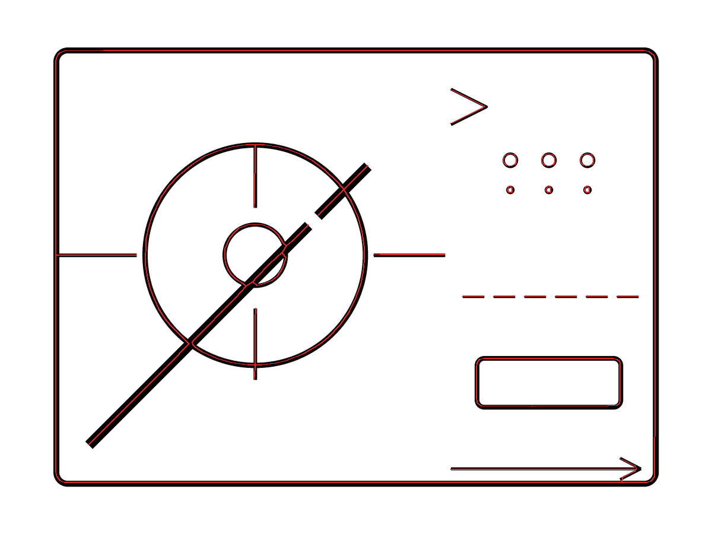
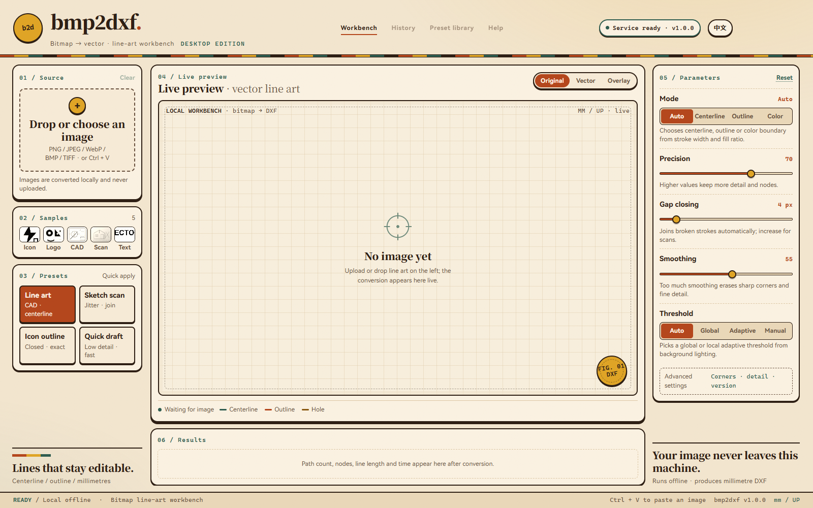
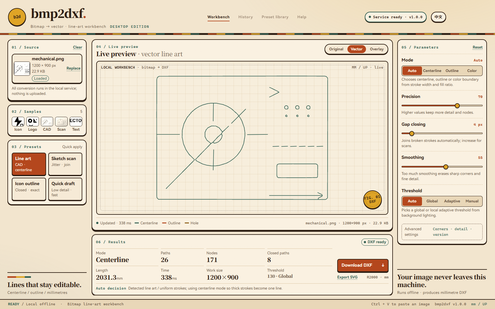
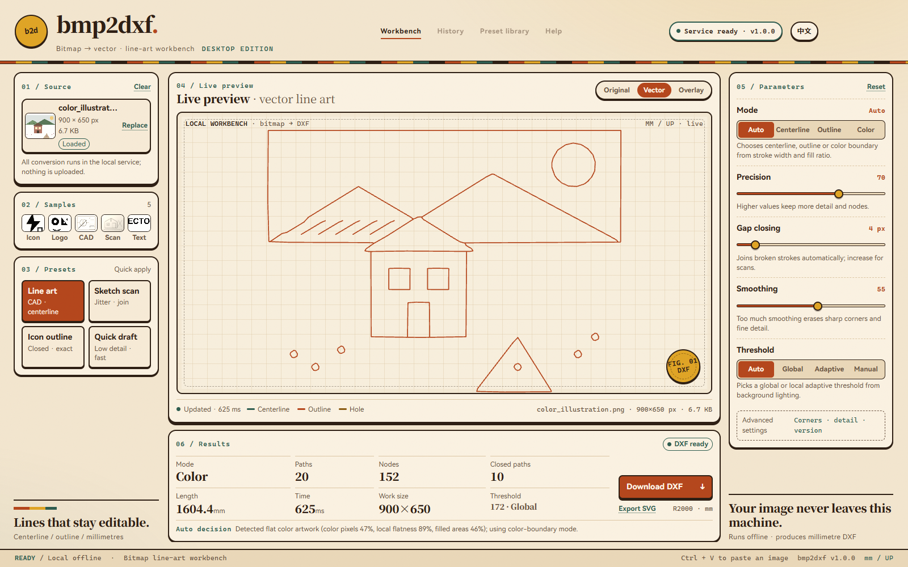

🌐 [简体中文](README.md) | **English**

# bmp2dxf · Bitmap → DXF Vectorizer 🖼️

Convert PNG / JPEG / WebP / BMP / TIFF and other bitmaps into **editable, machinable** DXF vector drawings.
It ships with three tracing engines — “centerline”, “outline”, and “color boundary” — with adjustable precision, plus dedicated handling for repeated thick lines, broken lines, crossings/overlaps, and lost detail.

[](LICENSE)
[](pyproject.toml)
[](https://github.com/CreationTV/bmp2dxf/actions/workflows/tests.yml)
[](pyproject.toml)



> 🖼️ Red lines are the generated DXF centerlines, overlaid on the source image. A 24 px thick line yields exactly one line; arcs, junctions, and holes stay continuous.

---

## Table of Contents

- [Problems It Solves](#problems-it-solves)
- [Features](#features)
- [Quick Start](#quick-start)
- [Web UI](#web-ui)
- [Command Line](#command-line)
- [Python API](#python-api)
- [Parameters](#parameters)
- [Choosing a Mode](#choosing-a-mode)
- [DXF Output](#dxf-output)
- [Precision and Performance](#precision-and-performance)
- [Tests and Quality Metrics](#tests-and-quality-metrics)
- [Project Structure](#project-structure)
- [FAQ](#faq)
- [Limitations](#limitations)
- [Development and Contributing](#development-and-contributing)
- [License](#license)

---

## Problems It Solves

Most “bitmap → DXF” tools simply trace the boundary of the black pixels, and the result cannot be edited in CAD:
one thick line turns into two parallel lines, junctions are broken, lines carry duplicated overlapping segments, and small details are filtered out.
bmp2dxf treats these problems as its core design goals:

| Problem | Why the conventional approach fails | How bmp2dxf handles it | Verification |
| --- | --- | --- | --- |
| **One thick line becomes several** | Extracting the boundary of the black region gives the contours on both sides of the line; or the skeleton forks at the end caps of a thick stroke | Centerline mode emits only **one** line through the middle of the stroke; short spurs forked off at the end caps are pruned, then the ends shortened by the skeleton are extended along the tangent back to the pen cap | 800×600, 24 px thick line → **1** open path, length 719 px (ideal 721 px) |
| **Lines are discontinuous** | Anti-aliasing / scan noise breaks thin lines; dashed and broken lines keep their gaps | Automatic thresholding (corrected Otsu / local adaptive) keeps thin lines in the mask; gaps are bridged in the vector domain by **tangent continuity**, with endpoints extended along their original direction | 32 px gap + 50 px connection distance → **1** continuous path |
| **Crossings are broken, overlapping, or littered with short segments** | At an X crossing the pixel skeleton forms two adjacent T junctions plus a short connecting segment; greedy linking easily picks the wrong direction | Junction clustering and short-link edge contraction; branches are paired by **tangent alignment** so one line continues through the crossing; near-duplicate lines are deduplicated | X crossing → **2** continuous straight lines (not 4 broken segments); a broken X → bridged in pairs along the diagonal, never joined into an H shape |
| **Lost detail** | Contour area thresholds, over-simplification, and global thresholds swallow faint strokes | Precision 0–100 controls working resolution, simplification tolerance, and minimum detail size together; outlines are traced at **sub-pixel** accuracy on the grayscale image; adaptive thresholding copes with uneven lighting; small holes and thin lines survive at high precision | Synthetic small-hole tests at precision 95 vs 20, the counters of O/R in text, and thin strokes in scanned sketches are all preserved |

In addition, auto mode analyzes the image first: uniform-stroke line art → centerline; large solid fills/icons → outline; flat colored areas and hand-drawn art → color boundary.
When the choice looks wrong the tool tells you, and you can switch with the UI or `--mode` in one step.

---

## Features

- 📦 **Formats**: PNG, JPEG, WebP, BMP, TIFF, GIF (first frame), ICO, PNM, TGA, PSD, JPEG 2000… any bitmap Pillow supports; EXIF orientation, palettes, and alpha channels (composited onto white) are handled automatically.
- 🧩 **Three vector engines**
  - **Centerline**: hand drawings, engineering drawings, scanned line art, single-stroke drawings → one editable polyline per stroke.
  - **Outline**: logos, icons, text, solid shapes → closed contours that keep inner and outer holes.
  - **Color boundary (color)**: colored hand drawings, illustrations, flat color blocks → traces the boundary between adjacent color regions and keeps inner color blocks and detail.
  - **Auto**: chosen automatically from fill area, stroke characteristics, and how flat the colors are.
- 🎚️ **Adjustable precision**: 0–100; a single slider balances “faithful” and “light” (DXF node count).
- 🔗 **Gap closing**: 0–40 source-image pixels, can be disabled; cubic Hermite curves keep the tangents continuous at the joins.
- 🧹 **Noise resistance and adaptive thresholding**: for scans, uneven lighting, and JPEG noise.
- 🖥️ **Real-time web UI**: drag-and-drop upload, slider tuning, source/vector/overlay previews, sample gallery, DXF/SVG download; fully local and available offline.
- ⌨️ **CLI**: single files, batch directories, JSON reports; suited to pipeline work.
- 📄 **DXF output**: millimeter units, Y-axis flip, layers (CENTERLINE / OUTLINE), LWPOLYLINE closed flags; optional R12/R2000/R2010/R2018; SVG preview export as well.
- 🧪 **Quality regression tests**: 104 automated cases covering the four core problem classes, color-region boundaries, formats, precision, DXF validity, and the web API.

---

## Quick Start

### Windows (recommended, simplest)

1. Install [Python 3.10+](https://www.python.org/downloads/) (tick *Add Python to PATH* during setup).
2. Double-click **`安装依赖.bat`** (first run only).
3. Double-click **`启动工具.bat`**; the browser opens <http://127.0.0.1:8765> automatically.

### macOS / Linux

```bash
chmod +x 安装依赖.sh 启动工具.sh
./安装依赖.sh
./启动工具.sh
```

### Manual start

```bash
python -m venv .venv
# Windows
.venv\Scripts\python -m pip install -r requirements.txt
.venv\Scripts\python -m pip install -e .
.venv\Scripts\python -m bmp2dxf.web --open
# on macOS / Linux, replace .venv\Scripts\ with .venv/bin/
```

> 💡 The only dependencies are `numpy`, `Pillow`, `scipy`, `scikit-image`, and `ezdxf` — all pure-Python or binary wheels, no compiler toolchain required.

---

## Web UI







Open <http://127.0.0.1:8765> after launching:

- Drag, click, or `Ctrl+V` to paste an image;
- Browse source material, samples, and quick presets on the left; click one to apply it immediately;
- On the right, adjust mode (auto / centerline / outline / color), precision, gap closing, smoothing strength, threshold method, and DPI;
- Switch the center preview between “Source / Vector / Overlay”; overlay opacity is adjustable, and the path count, node count, line length, elapsed time, automatic decision reason, and warnings are shown below;
- Colored hand drawings and flat color blocks are detected as “color” mode in auto mode, with the reasoning shown;
- Use the `EN / 中文` button in the top-right corner to switch the interface language; the choice is remembered in the browser;
- Click “Download DXF” for a file CAD can open directly, or export SVG.

Any parameter change triggers a debounced re-conversion — there is no need to press “Convert”.

> 💡 The web server listens on `127.0.0.1` only by default; images are never uploaded to any server, and it works with no network connection.

The legacy dark UI is kept in `bmp2dxf/web/legacy/`, which the server does not serve; to roll back, copy the three files back into `static/` as described in its `README.md`.

---

## Command Line

After installation the `bmp2dxf` command is available directly (or use `.venv\Scripts\python -m bmp2dxf` from the project directory):

```bash
# Single image: pick the mode automatically
bmp2dxf convert samples/mechanical.png -o out/mechanical.dxf

# Force centerline, precision 85, close gaps up to 16 px
bmp2dxf convert samples/mechanical.png -o out/mechanical.dxf \
  --mode centerline --precision 85 --gap 16

# Colored hand drawing / flat color blocks: trace boundaries between adjacent color regions
bmp2dxf convert illustration.png -o out/illustration.dxf --mode color

# Use a preset
bmp2dxf convert samples/logo.png --preset logo -o out/logo.dxf

# Batch-convert a directory (add -r to recurse)
bmp2dxf convert scans/ -o out/ --recursive --preset sketch --json

# Start the web UI (without opening a browser)
bmp2dxf serve --port 8765 --no-open

# List presets
bmp2dxf presets
```

Common options:

| Option | Default | Description |
| --- | --- | --- |
| `-m, --mode` | `auto` | `auto` / `centerline` / `outline` / `color` |
| `-p, --precision` | `70` | 0–100; higher keeps more detail and more nodes |
| `-g, --gap` | `4` | Gap-closing distance (source-image pixels); 0 = off |
| `--smoothing` | `55` | 0–100 smoothing strength; corners are preserved automatically |
| `--threshold-mode` | `auto` | `auto` / `otsu` / `adaptive` / `manual` |
| `--threshold` | – | Manual threshold 0–255 (required with `--threshold-mode manual`) |
| `--invert` | `auto` | `auto` / `yes` / `no`; inverts automatically for white lines on black |
| `--dpi` | `96` | Physical scale of the output DXF: `mm = px / dpi * 25.4` |
| `--dxf-version` | `R2000` | `R12` / `R2000` / `R2010` / `R2018` |
| `--min-detail` | auto | Minimum detail size (source-image pixels); 0 = derive from precision |
| `--no-denoise` | off | Disable the light Gaussian denoise |
| `--no-extend` | off | Do not extend line ends shortened by the skeleton |

---

## Python API

```python
from bmp2dxf import convert, ConvertOptions, to_dxf_bytes

result = convert(
    "samples/mechanical.png",
    ConvertOptions(mode="centerline", precision=85, gap_close=16),
)

print(result.stats.path_count, result.stats.point_count)
print(result.stats.total_length_mm, "mm")
for warning in result.warnings:
    print("Warning:", warning)

open("mechanical.dxf", "wb").write(to_dxf_bytes(result))
```

`convert()` accepts a file path, `bytes`, a binary stream, or a `PIL.Image`; coordinates in `result.paths` are **source-image pixel coordinates**, which makes custom processing or overlay previews easy.

More export options:

```python
from bmp2dxf.export.dxf import to_dxf
from bmp2dxf.export.svg import to_svg

to_dxf(result, "out.dxf", dpi=300, version="R2018")
open("preview.svg", "w", encoding="utf-8").write(to_svg(result))
```

---

## Parameters

| Parameter | Purpose | Effect of increasing / decreasing |
| --- | --- | --- |
| `mode` | Tracing engine | `centerline` emits single lines; `outline` emits closed contours; `color` emits color-region boundaries; `auto` decides automatically |
| `precision` | Master precision control | Higher: higher working resolution, tighter simplification tolerance, smaller details kept; lower: smoother curves, smaller DXF |
| `gap_close` | Gap bridging distance | Larger bridges bigger gaps/dashed lines, but too large may wrongly join neighbouring line ends |
| `smoothing` | Smoothing strength | Higher is smoother; genuine sharp corners are protected automatically by `corner_angle` |
| `threshold_method` | Binarization method | `otsu` for even lighting; `adaptive` for scans/gradients; `manual` for special images |
| `invert` | Foreground polarity | Set `yes` for white lines on black; use `auto` normally |
| `dpi` | Physical scale | Set 300 when the image is a real 300 dpi scan, so the DXF dimensions match real millimeters |
| `dxf_version` | DXF compatibility | `R12` for old software; otherwise keep `R2000` |
| `min_detail` | Minimum detail (source-image pixels) | Smaller keeps small holes/short lines but may keep noise; 0 means derive from precision |
| `corner_angle` | Corner preservation threshold | Corners sharper than this angle are never smoothed away; default 100° |

How precision maps to internal parameters (working image diagonal `D`, `p` = precision 0–100):

```
Working resolution cap   ≈ 950 + 14.5·p     (950 … 2400 px)
Simplification tolerance ≈ 0.3 + ((100-p)/100)^1.6 · 0.005·D
Minimum feature size     ≈ max(1.5, ((100-p)/100)^2 · 0.012·D) px
```

---

## Choosing a Mode

| Input type | Recommended mode | Result |
| --- | --- | --- |
| Engineering drawings, CAD screenshots, hand-drawn line art, signatures | `centerline` / `auto` | One editable line per stroke (thick lines reduced to single lines) |
| Single-line drawings / children's coloring line art | `centerline` | Centerline of the outline; suited to engraving, laser, and CNC cutting paths |
| Logos, icons, solid shapes | `outline` | Closed contours that keep the silhouette and holes |
| Colored hand drawings, illustrations, flat color blocks | `color` / `auto` | Traces boundaries between adjacent color blocks, keeping inner color regions and small blocks |
| Text to engraving paths | `outline` (for glyph shapes) or `centerline` (for single-line lettering) | Both are supported |
| Scans / photos of drawings | `auto` + adaptive thresholding | Handles uneven lighting automatically |
| Not sure | `auto` | Read the automatic decision reason first, then switch manually |

**Note**: centerline mode turns any “solid block” into its skeleton axis. For a solid circular logo the skeleton may be a cross or dotted line;
the UI warns “solid fill detected”, and you should switch to outline mode at that point. Color mode emits only color-region boundaries and does not fill colors;
flat colored images enter color mode first in auto mode, while black-and-white line art and icons still go through the original centerline/outline decision.

---

## DXF Output

- Units: **millimeters** (`$INSUNITS = 4`). Pixels → millimeters: `mm = px × 25.4 / dpi`.
- Coordinate system: the image Y axis points down, the DXF Y axis points up; the export flips it automatically.
- Entities: `LWPOLYLINE` (R2000+) or `POLYLINE` (R12); closed paths carry the `closed` flag.
- Layers:
  - `CENTERLINE` (cyan): centerline paths;
  - `OUTLINE` (white): outlines and holes.
- DXF defaults to the R2000 format and is compatible with AutoCAD, LibreCAD, QCAD, ZWCAD/GstarCAD, and others; R12 is available for old equipment.
- Sample files are in [`examples/`](examples/).

---

## Precision and Performance

- Working resolution is capped automatically at about 950–2400 px (set by precision); large images are downscaled with LANCZOS first, and small ones are upscaled a little before analysis.
- Measured on this machine (Windows / Python 3.14):

| Input | Mode / precision | Time | Paths |
| --- | --- | --- | --- |
| 600×450 | auto / 70 | ≈ 0.10 s | 20 |
| 1200×900 | auto / 82 | ≈ 0.21 s | 26 |
| 2400×1800 | centerline / 100 | ≈ 0.83 s | 26 |
| 4000×3000 | auto / 100 | ≈ 1.1 s | 26 |
| 1000×800 color logo | outline / 85 | ≈ 0.04 s | 8 |
| 900×650 flat-color illustration | color / 70 | ≈ 0.55 s | 20 |
| 320×240 color photo | auto / 70 | ≈ 0.17 s | 5 |

> 💡 Performance depends on line density, the number of crossings, and precision; anywhere from a few hundred milliseconds to a few seconds is normal.

---

## Tests and Quality Metrics

```bash
.venv\Scripts\python -m pytest -q
```

Test coverage:

- A 24 px thick line emits exactly 1 centerline, with quantified assertions on endpoint and center error;
- X crossing → 2 continuous straight lines; a broken X → correctly bridged in pairs;
- 32 px gaps, dashed lines, and broken-line bridging;
- Closed rings, T junctions, and parallel lines not wrongly joined;
- Detail retention at precision 95 vs 20;
- O/R counters in text, and outline classification of nested holes/islands;
- Auto mode (line art vs solid disc) and inversion detection;
- Flat colored images selecting color boundary mode automatically, inner boundaries between adjacent color blocks preserved, colored ink lines not doubled;
- Color photos not misdetected as flat artwork; safe fallback when a grayscale image is forced into color mode;
- Choice and effect of adaptive thresholding on lighting-gradient images;
- Common formats (PNG/JPEG/WebP/BMP/TIFF), palettes, RGBA, 16-bit grayscale;
- DXF parseable by ezdxf, millimeter units, Y flip, layers, closed flags, R12/R2000;
- CLI single file / batch / JSON;
- Web API and downloads.

Algorithm details: [docs/algorithm.md](docs/algorithm.md).

---

## Project Structure

```
bmp2dxf/
  config.py            parameters, presets, precision-to-tolerance mapping
  models.py            VectorPath / ConversionResult / Stats
  pipeline.py          full conversion pipeline
  cli.py               the bmp2dxf command line
  engine/
    image_io.py        image formats, alpha channel, EXIF, 16-bit grayscale
    preprocess.py      inversion detection, resizing, denoise, Otsu/adaptive threshold
    centerline.py      skeleton graph, junction pairing, gap bridging, endpoint extension
    outline.py         sub-pixel iso-contour outlines, hole classification
    color.py           color-region quantization, ink-line detection, color boundary tracing
    geometry.py        RDP, Chaikin, corner preservation, Hermite, deduplication
  export/
    dxf.py             ezdxf export (millimeters / layers / closed)
    svg.py             SVG preview export
  web/                 local web UI (stdlib HTTP server + front end)
scripts/               scripts that generate sample images and previews
samples/               demo images ready to drag into the UI
examples/              generated DXF samples
tests/                 automated tests
```

---

## FAQ

**Lines look thicker / turned into two parallel lines after conversion?**
That means outline mode was used. Outline mode traces edges faithfully, and a thick line genuinely has two edges; pick “centerline” mode for a single line.

**A line is broken — how do I connect it?**
Increase the “gap closing” distance; for scans, try the “hand-drawn scan” preset. Do not raise it too far at once, or neighbouring line ends may be wrongly joined.

**Faint thin lines are missing?**
Raise the manual threshold (the rule here is “grayscale below the threshold counts as ink”, so a higher threshold includes more faint lines), or switch to the “local adaptive” threshold. Toggling inversion may also help.

**The DXF dimensions are wrong?**
Set the correct `dpi`. For example, a 300 dpi scan should use 300; an image 3000 px wide then becomes 254 mm wide in the DXF.

**Holes disappeared?**
Raise precision, or lower `min_detail` (e.g. 1–2 px). Outline mode keeps holes; centerline mode does not output fills.

**Too many nodes / file too large after conversion?**
Lower precision or raise the smoothing strength; in outline mode you can increase the simplification tolerance (controlled through precision).

**Colored hand drawings / continuous color blocks lose detail?**
Use “color” mode, or keep “auto” — it detects flat colored artwork as color boundary mode. Color mode traces boundaries between adjacent color regions, so inner regions such as sky, color blocks, and flower dots are not merged just because their grays are close.

**Can color photos be converted?**
Color mode targets flat-colored hand drawings, not continuous-tone photos; photos may produce many small fragments, and auto mode will not misclassify them as flat artwork. For photos, use centerline/outline mode first, or pre-process them into line art.

---

## Limitations

- Centerline mode only produces skeletons for solid blocks and keeps no fill; use outline mode when you need the silhouette.
- Heavily blurred, very low-resolution, or halftone images may need pre-processing.
- Junction pairing relies on tangent continuity and may be imperfect on very dense mesh-like patterns (e.g. complex hatching).
- Color mode quantizes the image into at most 12 color regions and then traces region boundaries; gradients, watercolor washes, or discontinuous-tone images may produce many small fragments — it suits flat-colored hand drawings with clear color blocks.
- DXF contains lines (polylines) only, with no fills/hatching; it suits cutting, engraving, and tracing, not direct rendering of solid images.
- Auto mode is a heuristic; unusual styles may need a manual mode switch.

---

## Development and Contributing

```bash
git clone https://github.com/CreationTV/bmp2dxf.git
cd bmp2dxf
python -m venv .venv
.venv\Scripts\python -m pip install -e ".[dev]"
.venv\Scripts\python -m pytest -q
```

- Regenerating sample/preview images: `python scripts/make_samples.py`, `python scripts/make_examples.py`
- Code style: standard library + type hints; the core algorithms do not depend on the UI.
- Issues / PRs are welcome: new failure cases (image + expectation) are the most helpful.

---

## License

[MIT](LICENSE) © 2026 CreationTV
