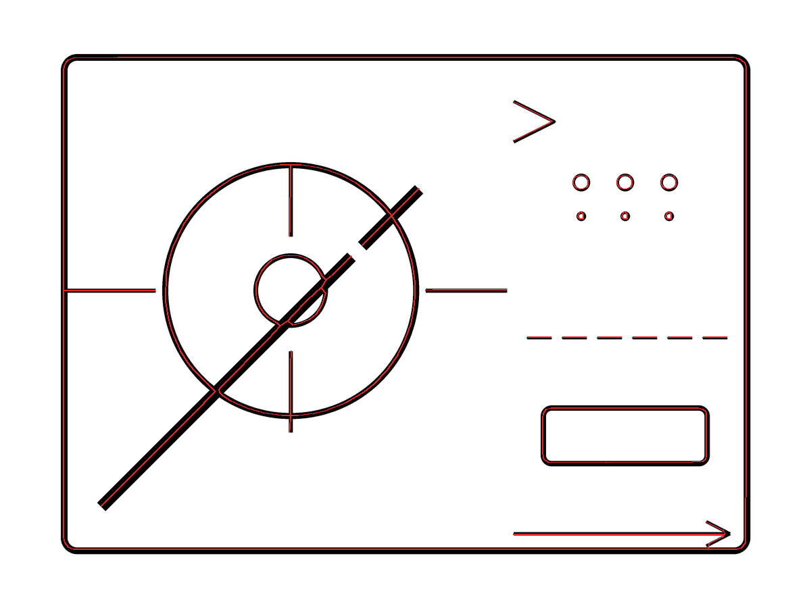
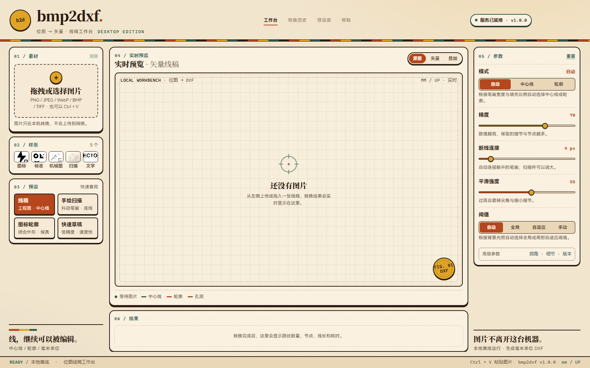
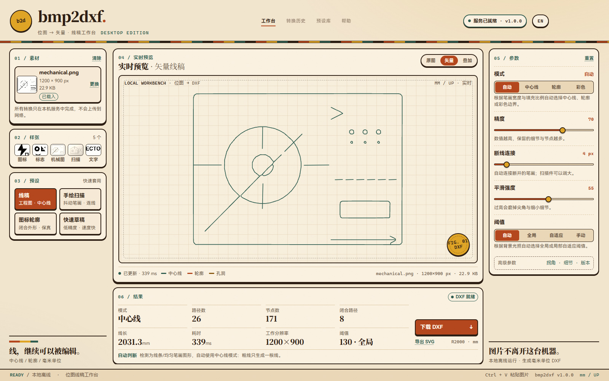
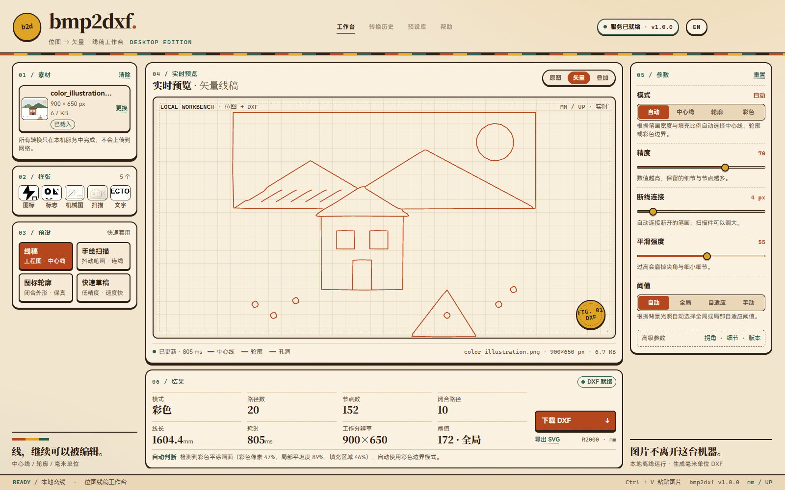

🌐 [**简体中文**](README.md) | [English](README.en.md)

# bmp2dxf · 位图转 DXF 矢量图工具 🖼️

把 PNG / JPEG / WebP / BMP / TIFF 等位图转换成 **可编辑、可加工** 的 DXF 矢量图。
内置「中心线」「轮廓」「彩色边界」三套追踪引擎，可调精度，并针对粗线重复、断线、交叉重叠、细节丢失做了专门处理。

[](LICENSE)
[](pyproject.toml)
[](https://github.com/CreationTV/bmp2dxf/actions/workflows/tests.yml)
[](pyproject.toml)
[](https://github.com/CreationTV/bmp2dxf/releases/latest)



> 🖼️ 红色为生成的 DXF 中心线，覆盖在原图上。一根 24 px 粗线只输出一根线，圆弧、交叉口和孔洞均保持连续。

---

## 目录

- [它解决了哪些问题](#它解决了哪些问题)
- [功能特性](#功能特性)
- [快速开始](#快速开始)
- [Web 界面](#web-界面)
- [命令行](#命令行)
- [Python API](#python-api)
- [参数说明](#参数说明)
- [模式怎么选](#模式怎么选)
- [DXF 输出说明](#dxf-输出说明)
- [精度与性能](#精度与性能)
- [测试与质量指标](#测试与质量指标)
- [项目结构](#项目结构)
- [常见问题](#常见问题)
- [限制](#限制)
- [开发与贡献](#开发与贡献)
- [License](#license)

---

## 它解决了哪些问题

很多「位图转 DXF」工具只是把黑色像素的边界描出来，结果放在 CAD 里无法编辑：
一根粗线变成两条平行线、交点是断的、线上有重复重叠的小段、小细节被过滤掉。
bmp2dxf 把这些问题当作核心设计目标：

| 问题 | 传统做法为什么出错 | bmp2dxf 的处理 | 验证 |
| --- | --- | --- | --- |
| **一根粗线条变成多根** | 直接提取黑色区域边界，得到的是线两侧的轮廓；或骨架在粗线端帽处分叉 | 中心线模式只输出**一根**穿过笔画中心的线；剪掉端帽分叉的短刺，再沿切线把被骨架缩短的线端补回到笔帽 | 800×600、24 px 粗线 → **1 条**开放路径，长度 719 px（理想 721 px） |
| **线条不连续** | 抗锯齿/扫描噪点让细线断开；虚线、断线直接保留断口 | 自动阈值（Otsu 修正 / 局部自适应）保证细线入掩膜；矢量域按**切线连续性**桥接断口，端点沿原方向补齐 | 32 px 断口 + 连接距离 50 px → **1 条**连续路径 |
| **交叉处断开、重叠、多出短线** | 像素骨架在 X 交叉处会形成两个相邻 T 交叉 + 一小段连接线；贪心连接容易接错方向 | 交叉口聚类与短连接边收缩；按**切线对直**配对分支，使一条线穿过交叉口继续走；近似重复的线去重 | X 交叉 → **2 条**连续直线（不是 4 段断线）；断开的 X → 按对角线成对桥接，不会接成 H 形 |
| **细节丢失** | 轮廓面积阈值、过度简化、全局阈值吞掉浅色笔画 | 精度 0–100 同时控制工作分辨率、简化容差与最小细节尺寸；轮廓在灰度图上做**亚像素**追踪；自适应阈值应对光照不均；高精度下保留小孔洞和细线 | 精度 95 与 20 的合成小孔测试、文字 O/R 内孔、扫描草图细线均被保留 |

此外，自动模式会先分析图像：均匀笔画线稿 → 中心线；大面积实心填充/图标 → 轮廓；平坦的彩色平涂/手绘 → 彩色边界。
选择错误时工具会给出提示，你可以用 UI 或 `--mode` 一键切换。

---

## 功能特性

- 📦 **格式**：PNG、JPEG、WebP、BMP、TIFF、GIF（第一帧）、ICO、PNM、TGA、PSD、JPEG 2000……一切 Pillow 支持的位图；自动处理 EXIF 方向、调色板、透明通道（合成到白底）。
- 🧩 **三种矢量引擎**
  - **中心线（centerline）**：手绘、工程图、扫描线稿、单线绘制图 → 每个笔画一根可编辑多段线。
  - **轮廓（outline）**：Logo、图标、文字、实心形状 → 闭合轮廓，保留内外孔洞。
  - **彩色边界（color）**：彩色手绘、插画、平涂色块 → 追踪相邻颜色区域之间的边界，保留内部色块和细节。
  - **自动（auto）**：根据填充面积/笔画特征/彩色平涂程度自动选择。
- 🎚️ **可调精度**：0–100，一个滑块同时平衡“像”和“轻”（DXF 节点数）。
- 🔗 **断线连接**：0–40 原图像素，可关闭；使用三次 Hermite 曲线保证连接处切线连续。
- 🧹 **抗噪与自适应阈值**：针对扫描件、光照不均、JPEG 噪点。
- 🖥️ **实时 Web 界面**：拖拽上传、滑块调参、原图/矢量/叠加预览、示例画廊、DXF/SVG 下载；右上角 `EN / 中文` 按钮一键切换界面语言并自动记忆；完全本地运行、离线可用。
- ⌨️ **CLI**：单文件、批量目录、JSON 报告；适合流水线作业。
- 📄 **DXF 输出**：毫米单位、Y 轴翻转、图层（CENTERLINE / OUTLINE）、LWPOLYLINE 闭合标记；可选 R12/R2000/R2010/R2018；同时支持导出 SVG 预览。
- 🧪 **质量回归测试**：104 个自动化用例，覆盖四类核心问题、彩色色块边界、格式、精度、DXF 合法性与 Web API。

---

## 快速开始

### Windows 便携版（推荐，无需安装 Python）

1. 打开 [Releases](https://github.com/CreationTV/bmp2dxf/releases/latest) 下载 `bmp2dxf-portable-windows-x64-v1.1.1.zip`。
2. 解压到任意文件夹（不要在压缩包内直接运行）。
3. 双击 **`bmp2dxf.exe`**，浏览器会自动打开本地工作台；关闭控制台窗口即停止服务。

便携版内置 Python 运行时、转换依赖和示例图片，不写注册表，也不上传图片。首次运行若遇到 Windows SmartScreen 提示，点「更多信息 → 仍要运行」即可；发布包同时提供 `SHA256SUMS.txt` 校验值。

也可以在命令行中使用便携版：

```bat
bmp2dxf.exe convert samples\mechanical.png -o out\mechanical.dxf
bmp2dxf.exe --version
```

发布说明见 [docs/release-v1.1.1.md](docs/release-v1.1.1.md)。

### Windows 从源码运行

1. 安装 [Python 3.10+](https://www.python.org/downloads/)（安装时勾选 *Add Python to PATH*）。
2. 双击 **`安装依赖.bat`**（只需第一次运行）。
3. 双击 **`启动工具.bat`**，浏览器会自动打开 <http://127.0.0.1:8765>。

### macOS / Linux

```bash
chmod +x 安装依赖.sh 启动工具.sh
./安装依赖.sh
./启动工具.sh
```

### 手动启动

```bash
python -m venv .venv
# Windows
.venv\Scripts\python -m pip install -r requirements.txt
.venv\Scripts\python -m pip install -e .
.venv\Scripts\python -m bmp2dxf.web --open
# macOS / Linux 把 .venv\Scripts\ 换成 .venv/bin/
```

> 依赖只有 `numpy`、`Pillow`、`scipy`、`scikit-image`、`ezdxf`，全部为纯 Python/二进制轮子，无需编译工具链。

---

## Web 界面







启动后访问 <http://127.0.0.1:8765>：

- 拖拽 / 点击 / `Ctrl+V` 粘贴图片；
- 左侧查看素材、样张与快捷预设，点选后立即套用；
- 右侧调整模式（自动 / 中心线 / 轮廓 / 彩色）、精度、断线连接、平滑强度、阈值方式与 DPI；
- 中间用「原图 / 矢量 / 叠加」切换预览，叠加模式可调透明度，下方查看路径数、节点数、线长、耗时、自动判断理由与警告；
- 彩色手绘/平涂色块在自动模式下会识别为「彩色」模式，并给出判断理由；
- 点击「下载 DXF」得到 CAD 可直接打开的文件，也可以导出 SVG；
- 右上角 `EN / 中文` 按钮切换中英文界面，选择会保存在浏览器里。

参数一变即防抖重转，无需手动点“转换”。

> Web 服务默认只监听 `127.0.0.1`，图片不会上传到任何服务器，断网也能用。

旧版深色界面保留在 `bmp2dxf/web/legacy/`，服务器不会提供该目录；需要回退时按其中的 `README.md` 把三个文件复制回 `static/`。

---

## 命令行

安装后可直接使用 `bmp2dxf` 命令（或在项目目录用 `.venv\Scripts\python -m bmp2dxf`）：

```bash
# 单张：自动选择模式
bmp2dxf convert samples/mechanical.png -o out/mechanical.dxf

# 强制中心线、精度 85、连接 16 px 断口
bmp2dxf convert samples/mechanical.png -o out/mechanical.dxf \
  --mode centerline --precision 85 --gap 16

# 彩色手绘 / 平涂色块：追踪相邻颜色区域边界
bmp2dxf convert illustration.png -o out/illustration.dxf --mode color

# 使用预设
bmp2dxf convert samples/logo.png --preset logo -o out/logo.dxf

# 批量转换目录（可加 -r 递归）
bmp2dxf convert scans/ -o out/ --recursive --preset sketch --json

# 启动网页界面（不自动开浏览器）
bmp2dxf serve --port 8765 --no-open

# 查看预设
bmp2dxf presets
```

常用选项：

| 选项 | 默认 | 说明 |
| --- | --- | --- |
| `-m, --mode` | `auto` | `auto` / `centerline` / `outline` / `color` |
| `-p, --precision` | `70` | 0–100，越高细节越多、节点越多 |
| `-g, --gap` | `4` | 断线连接距离（原图像素），0 = 关闭 |
| `--smoothing` | `55` | 0–100 平滑强度，拐角会自动保留 |
| `--threshold-mode` | `auto` | `auto` / `otsu` / `adaptive` / `manual` |
| `--threshold` | – | 手动阈值 0–255（`--threshold-mode manual` 时必填） |
| `--invert` | `auto` | `auto` / `yes` / `no`，白线黑底时自动反相 |
| `--dpi` | `96` | 输出 DXF 的物理比例：`mm = px / dpi * 25.4` |
| `--dxf-version` | `R2000` | `R12` / `R2000` / `R2010` / `R2018` |
| `--min-detail` | 自动 | 最小细节尺寸（原图像素），0 = 按精度自动 |
| `--no-denoise` | 关 | 关闭轻微高斯去噪 |
| `--no-extend` | 关 | 不自动补齐被骨架缩短的线端 |

---

## Python API

```python
from bmp2dxf import convert, ConvertOptions, to_dxf_bytes

result = convert(
    "samples/mechanical.png",
    ConvertOptions(mode="centerline", precision=85, gap_close=16),
)

print(result.stats.path_count, result.stats.point_count)
print(result.stats.total_length_mm, "mm")
for warning in result.warnings:
    print("警告:", warning)

open("mechanical.dxf", "wb").write(to_dxf_bytes(result))
```

`convert()` 接受文件路径、`bytes`、二进制流或 `PIL.Image`；`result.paths` 中的坐标是**原图像素坐标**，方便自定义处理或叠加预览。

更多导出：

```python
from bmp2dxf.export.dxf import to_dxf
from bmp2dxf.export.svg import to_svg

to_dxf(result, "out.dxf", dpi=300, version="R2018")
open("preview.svg", "w", encoding="utf-8").write(to_svg(result))
```

---

## 参数说明

| 参数 | 作用 | 调大 / 调小的效果 |
| --- | --- | --- |
| `mode` | 追踪引擎 | `centerline` 输出单线；`outline` 输出闭合轮廓；`color` 输出颜色区域边界；`auto` 自动判断 |
| `precision` | 精度总开关 | 调高：工作分辨率更高、简化容差更小、保留更小细节；调低：曲线更顺、DXF 更小 |
| `gap_close` | 断线桥接距离 | 调大可连接更大的断口/虚线，但过大可能误连相邻线端 |
| `smoothing` | 平滑强度 | 调高更顺滑；真实尖角由 `corner_angle` 自动保护 |
| `threshold_method` | 二值化方式 | 均匀光照用 `otsu`；扫描/渐变用 `adaptive`；特殊图片可 `manual` |
| `invert` | 前景极性 | 黑底白线设为 `yes`；一般用 `auto` |
| `dpi` | 物理尺寸比例 | 图片实际是 300 dpi 扫描件时设为 300，DXF 尺寸才符合真实毫米 |
| `dxf_version` | DXF 兼容性 | 老旧软件选 `R12`；一般保持 `R2000` |
| `min_detail` | 最小细节（原图像素） | 调小保留小孔/短线，但可能留下噪点；0 表示按精度自动 |
| `corner_angle` | 拐角保留阈值 | 夹角小于该值的角不会被平滑掉，默认 100° |

精度与内部参数的对应关系（工作图对角线 `D`，`p` 为精度 0–100）：

```
工作分辨率上限   ≈ 950 + 14.5·p     (950 … 2400 px)
简化容差         ≈ 0.3 + ((100-p)/100)^1.6 · 0.005·D
最小特征尺寸     ≈ max(1.5, ((100-p)/100)^2 · 0.012·D) px
```

---

## 模式怎么选

| 输入类型 | 推荐模式 | 结果 |
| --- | --- | --- |
| 工程图、CAD 截图、手绘线稿、签字 | `centerline` / `auto` | 每个笔画一根可编辑线（粗线单线化） |
| 单线画 / 儿童涂色线稿 | `centerline` | 轮廓中线，适合雕刻、激光、CNC 走刀 |
| Logo、图标、实心图形 | `outline` | 闭合轮廓，保留外形和孔洞 |
| 彩色手绘、插画、平涂色块 | `color` / `auto` | 追踪相邻色块之间的边界，保留内部颜色分区和小色块 |
| 文字转雕刻路径 | `outline`（要字形）或 `centerline`（要单线字） | 两者都支持 |
| 扫描件 / 拍照稿 | `auto` + 自适应阈值 | 自动处理光照不均 |
| 不确定 | `auto` | 先看自动判断理由，再手动切换 |

**注意**：中心线模式会把任何“实心块”变成它的骨架中轴。对圆形实心 Logo，骨架可能是十字/点状线；
UI 会自动提示“检测到实心填充区域”，此时请切换到轮廓模式。彩色模式只输出颜色区域边界，不填充颜色；
彩色平涂图在自动模式下会优先进入彩色模式，黑白线稿/图标仍走原来的中心线/轮廓判断。

---

## DXF 输出说明

- 单位：**毫米**（`$INSUNITS = 4`）。像素 → 毫米：`mm = px × 25.4 / dpi`。
- 坐标系：图像 Y 轴向下，DXF Y 轴向上，导出时自动翻转。
- 实体：`LWPOLYLINE`（R2000+）或 `POLYLINE`（R12），闭合路径带 `closed` 标记。
- 图层：
  - `CENTERLINE`（青色）：中心线路径；
  - `OUTLINE`（白色）：轮廓与孔洞。
- DXF 默认 R2000 格式，兼容 AutoCAD、LibreCAD、QCAD、中望/浩辰等；老设备可选 R12。
- 示例文件见 [`examples/`](examples/)。

---

## 精度与性能

- 工作分辨率自动限制在约 950–2400 px（由精度决定），大图先 LANCZOS 缩放，小图适当放大后再分析。
- 本机实测（Windows / Python 3.14）：

| 输入 | 模式/精度 | 用时 | 路径数 |
| --- | --- | --- | --- |
| 600×450 | auto / 70 | ≈ 0.10 s | 20 |
| 1200×900 | auto / 82 | ≈ 0.21 s | 26 |
| 2400×1800 | centerline / 100 | ≈ 0.83 s | 26 |
| 4000×3000 | auto / 100 | ≈ 1.1 s | 26 |
| 1000×800 彩色 Logo | outline / 85 | ≈ 0.04 s | 8 |
| 900×650 彩色平涂插画 | color / 70 | ≈ 0.55 s | 20 |
| 320×240 彩色照片 | auto / 70 | ≈ 0.17 s | 5 |

> 性能取决于线条密度、交叉口数量和精度；几百毫秒到几秒都在正常范围。

---

## 测试与质量指标

```bash
.venv\Scripts\python -m pytest -q
```

测试覆盖：

- 24 px 粗线只输出 1 条中心线，端点与中心误差量化断言；
- X 交叉 → 2 条连续直线；断开的 X → 正确成对桥接；
- 32 px 断口、虚线、断线桥接；
- 闭合圆环、T 型交叉、平行线不误连；
- 精度 95 vs 20 的细节保留差异；
- 文字 O/R 孔洞、嵌套孔洞/岛屿的轮廓分类；
- 自动模式（线稿 vs 实心盘）与反相检测；
- 彩色平涂图自动选择彩色边界模式、相邻色块内部边界保留、彩色墨线不产生双线；
- 彩色照片不会被自动误判为平涂画面；灰度图强制彩色模式时安全回退；
- 自适应阈值在光照渐变图上的选择与效果；
- 常见格式（PNG/JPEG/WebP/BMP/TIFF）、调色板、RGBA、16 位灰度；
- DXF 可被 ezdxf 解析、毫米单位、Y 翻转、图层、闭合标记、R12/R2000；
- CLI 单文件/批量/JSON；
- Web API 与下载。

算法细节见 [docs/algorithm.md](docs/algorithm.md)。

---

## 项目结构

```
bmp2dxf/
  config.py            参数、预设、精度到内部容差的映射
  models.py            VectorPath / ConversionResult / Stats
  pipeline.py          完整转换流水线
  cli.py               bmp2dxf 命令行
  portable.py          便携版入口：无参数启动本地 Web 工作台
  engine/
    image_io.py        图片格式、透明通道、EXIF、16 位灰度
    preprocess.py      反相判断、缩放、去噪、Otsu/自适应阈值
    centerline.py      骨架图、交叉口配对、断线桥接、端点延伸
    outline.py         亚像素等值线轮廓、孔洞分类
    color.py           彩色区域量化、墨线识别、颜色边界追踪
    geometry.py        RDP、Chaikin、拐角保留、Hermite、去重
  export/
    dxf.py             ezdxf 导出（毫米/图层/闭合）
    svg.py             SVG 预览导出
  web/                 本地 Web UI（标准库 HTTP 服务 + 前端）
packaging/             PyInstaller 入口、图标和 Windows 版本资源
bmp2dxf.spec           PyInstaller one-folder 打包配置
scripts/               示例图、预览和便携版构建脚本
samples/               可直接拖进 UI 的演示图片
examples/              已生成的 DXF 示例
tests/                 自动化测试
```

---

## 常见问题

**转换后线条变粗、变成两条平行线？**
说明用了轮廓模式。轮廓模式忠实描边，粗线本来就有两条边；要单线请选「中心线」模式。

**线断了，怎么连？**
增大「断线连接」距离；对扫描件建议用「手绘扫描」预设。不要一次调太大，避免误连相邻线端。

**浅色细线没出来？**
提高手动阈值（本工具的规则是“灰度小于阈值视为墨迹”，阈值调高会包含更多浅色线），或改用「局部自适应」阈值。也可以尝试切换反相。

**DXF 尺寸不对？**
设置正确的 `dpi`。例如扫描稿是 300 dpi，就设 300；图像像素宽度 3000 时 DXF 宽度为 254 mm。

**孔洞没了？**
提高精度，或把 `min_detail` 调小（如 1–2 px）。轮廓模式会保留孔洞；中心线模式不输出填充。

**转换后节点太多/文件太大？**
降低精度或提高平滑强度；轮廓模式可适当增大简化容差（通过精度控制）。

**彩色手绘/连续色块细节丢了？**
使用「彩色（color）」模式，或保持「自动」——它会把平坦的彩色平涂图识别为彩色边界模式。彩色模式追踪相邻颜色区域之间的边界，因此天空、色块、花点等内部区域不会因为灰度相近而合并。

**彩色照片能转吗？**
彩色模式面向平涂手绘图，不面向连续色调照片；照片可能出现大量碎线，自动模式不会把它误判为彩色平涂。照片建议先用中心线/轮廓模式或先做描线预处理。

---

## 限制

- 中心线模式对实心块只生成骨架，不保留填充；需要外形请用轮廓模式。
- 严重模糊、极低分辨率、半调网点图可能需要先预处理。
- 交叉口配对基于切线连续性，对极密集的网状图案（如复杂阴影线）可能不完美。
- 彩色模式把图像量化为最多 12 个颜色区，再追踪区域边界；渐变、水彩晕染或不连续色调的图可能产生较多碎线，适合平涂/色块清晰的手绘图。
- DXF 只输出线（多段线），不包含填充/图案填充；适合切割、雕刻、描图，不适合直接渲染实心图。
- 自动模式是启发式判断，特殊风格图可能需手动切换模式。

---

## 开发与贡献

```bash
git clone https://github.com/CreationTV/bmp2dxf.git
cd bmp2dxf
python -m venv .venv
.venv\Scripts\python -m pip install -e ".[dev]"
.venv\Scripts\python -m pytest -q
```

- 示例图/预览图重新生成：`python scripts/make_samples.py`、`python scripts/make_examples.py`
- Windows 便携版构建：

  ```bat
  .venv\Scripts\python -m pip install -e ".[build]"
  .venv\Scripts\python scripts\build_portable.py
  ```

  输出 `dist/bmp2dxf-portable/`、`dist/bmp2dxf-portable-windows-x64-v1.1.1.zip` 和 `dist/SHA256SUMS.txt`。
- 应用图标重新生成：`python scripts/make_icon.py`
- 代码风格：标准库 + 类型注解；核心算法不依赖 UI。
- 欢迎提交 Issue / PR：新的失败样例（图片 + 期望）最有帮助。

---

## License

[MIT](LICENSE) © 2026 CreationTV
