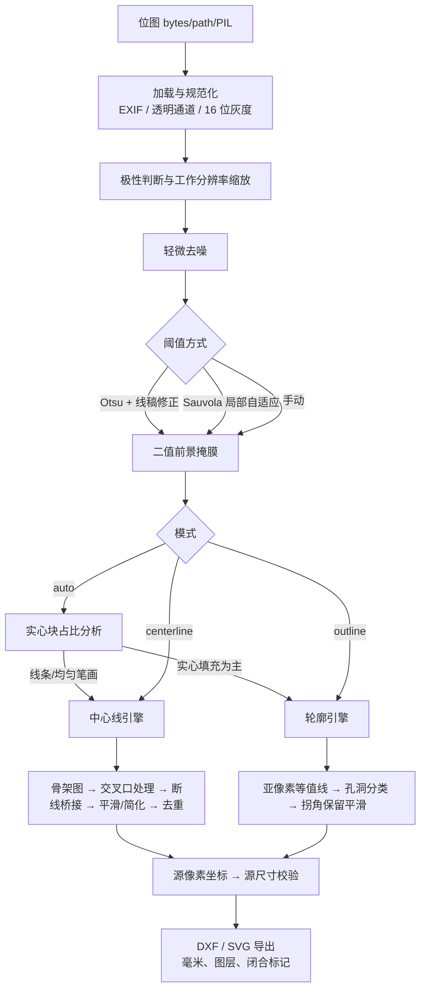

# bmp2dxf 算法说明

本文说明 bmp2dxf 如何把一张位图变成干净的 DXF 多段线，重点解释四个目标问题：
**粗线重复、断线、交叉重叠、细节丢失** 的处理方式。

## 总览



核心实现位于：

- `bmp2dxf/engine/preprocess.py` — 加载后的灰度标准化与二值化
- `bmp2dxf/engine/centerline.py` — 中心线图算法
- `bmp2dxf/engine/outline.py` — 轮廓追踪
- `bmp2dxf/engine/geometry.py` — 折线几何、平滑、桥接、去重
- `bmp2dxf/export/dxf.py`、`svg.py` — 输出

所有内部计算都在 **工作图坐标** 中进行，最后再按 `工作图/原图` 的比例缩放回原图像素坐标，
这样外部拿到的路径坐标与原始图片完全对齐，便于叠加预览和二次处理。

---

## 1. 图像加载与规范化

- Pillow 解码；`ImageOps.exif_transpose` 处理手机照片方向。
- 透明通道：先合成到白底，避免彩色/透明 PNG 的黑色背景判断错误。
- 调色板 / CMYK / YCbCr 等模式统一转换为 8 位灰度。
- 16 位灰度按实际动态范围归一化到 0–255；`I`、`F` 模式同理。
- 动图只取第一帧并给出提示。

### 极性判断

真实素材可能是「黑底白线」。取图片四周的窄边框带，求中位数亮度：

- 边框偏暗（中位数 < 110）→ 白线黑底，反相为“前暗后亮”；
- 否则保持原样。

也可以用 `invert=yes/no` 强制指定。阈值与后续所有掩膜都基于“前景比背景暗”这一统一约定。

### 工作分辨率

精度 `p ∈ [0,100]` 决定工作图上限：

```
target_max_dim = 950 + 14.5·p        # 950 … 2400 px
```

- 输入最长边大于上限：LANCZOS 缩小（超大图片先降采样，保证速度）。
- 输入最长边小于 700：适当放大（最多 8 倍，目标 700 px），避免 64 px 小图标在亚像素/骨架阶段抖动。
- 缩放因子写入结果统计，最终路径坐标除以该因子恢复原图坐标。

### 轻微去噪

对灰度图施加很小的 Gaussian 模糊（`σ ≈ 0.35–0.8`，精度越低越强），减少像素锯齿造成的骨架毛刺。
如果输入本身很干净，可以用 `--no-denoise` 关闭。

---

## 2. 二值化

### 2.1 Otsu 的“稀疏墨迹”修正

标准 Otsu 在前景（墨迹）占比很小时，类间方差曲线可能非常平坦，
阈值会滑到靠近墨迹的一侧；对黑线白纸的 1–2 px 细线，这会把抗锯齿边缘甚至整条浅线丢掉。

因此对 Otsu 阈值做一次稳健修正：

```python
t = otsu(gray)
lo, hi = percentile(gray, [1, 99])
if hi - lo >= 20:
    if t < lo + 0.25*(hi-lo) or t > lo + 0.75*(hi-lo):
        t = (lo + hi) / 2
```

直观含义：如果 Otsu 解落在墨迹或纸面附近，就退回“墨迹/纸面中值”。这样黑线白纸上得到约 127，
而不是 40–50；抗锯齿灰边与浅色细线能被完整保留。

### 2.2 局部自适应阈值

扫描件常有光照不均。`auto` 模式用 **分块背景亮度分析** 决定是否启用 Sauvola：

1. 按 6×6（或更少）分块；
2. 每块取 80 分位亮度作为该块背景亮度；
3. 忽略亮度 < 100 的块（大部分是墨迹的块没有可用的背景估计）；
4. 若有效块背景亮度的 P90−P10 超过 12/255，判定光照不均，切换到 Sauvola；
5. 否则用修正后的 Otsu。

只统计背景块，避免“实心大块图案”被误判为光照不均。
用户也可以手动选择 `adaptive` / `manual`。

### 2.3 空白与异常提示

- 前景占比 < 0.02%：提示“几乎没检测到线条”，建议调整阈值/反相；
- 前景占比 > 92%：提示可能背景反了；
- 连续色调照片：直方图中灰调占比高时提示先做描线预处理；
- 大图缩小/小图放大的操作也会写入 `warnings`。

---

## 3. 自动模式判断

自动模式不靠“照片风格”猜，而是判断**墨迹面积主要来自细长笔画还是成片实心块**：

1. 计算前景连通域和距离变换 `dt`（每个前景像素到最近背景的距离）。
2. 对每个分量：
   - 外接矩形长宽比 ≤ 3；
   - 最大内切半径 `max(dt) ≥ max(8, 0.045 × 图像对角线)`；
   - 分量面积不太小；
   
   满足者记为“实心块”。
3. 实心块面积占全部墨迹面积 > 20% → 轮廓模式；否则中心线模式。

为什么不是看最大内切半径本身？因为一根很粗的长线条也有很大的内切半径，
但它的外接矩形是细长的，长宽比会把它排除。实心圆、实心三角形、粗笔画 Logo 则会命中。

手动选择 `centerline` 而图中存在大量实心块时，pipeline 会追加一条友好警告，建议切换模式。

---

## 4. 中心线引擎

中心线模式的输入是布尔前景掩膜，输出是若干折线（`VectorPath(kind="centerline")`）。

### 4.1 骨架化

使用 `skimage.morphology.skeletonize`（Zhang-Suen）得到 8 连通单像素骨架，
同时用 `scipy.ndimage.distance_transform_edt` 计算距离变换，后续用于：

- 端帽延伸长度（骨架在粗线端头会回缩约一个半径）；
- 端点毛刺/端帽分叉的自适应修剪；
- 自动模式判断。

### 4.2 构建骨架图

1. 统计每个骨架像素的 8 邻域数：`deg ≥ 3` 为交叉像素，`deg = 1` 为端点。
2. 对交叉像素做 3×3 膨胀并连通成“交叉口簇”，避免一个 X 交叉被拆成多个点。
3. 从骨架中移除交叉口簇，剩下的是互不相连的**简单路径或闭环**；
   逐分量按邻接关系排序成像素点列。
4. 每个路径端点的 8 邻域若与交叉口簇相邻，则连接到该交叉口；
   否则是自由端。
5. 图节点 = 交叉口簇，边 = 路径；外加无节点的闭环边。

### 4.3 收缩短交叉边

像素骨架上的一个 X 交叉，经常表现为 **两个相邻 T 交叉 + 中间一小段连接边**。
如果直接处理，会剩下一小段“中间线”或配对错乱。

处理：把长度 ≤ `max(5, 2.5×缩放因子)` 且两端都是交叉口的边视为交叉口内部连接，
用并查集合并两端交叉口，删除这条内部边。合并后的交叉口中心取所有成员交叉像素的均值。

### 4.4 剪刺（Spur pruning）

骨架会在粗线端帽、噪声突起处产生短分叉。迭代删除“一端自由、长度过短”的边：

```
spur_limit = max(鼓包阈值, 1.5 × 局部内切半径)
```

- 普通细线：按精度推导的最小长度（约 3–10 px）；
- 粗线端帽：局部半径大，阈值自动变大，恰好删除端帽 Y 形分叉；
- 剪完若交叉口只剩一个分支，就把该交叉口降级为普通自由端，
  之后由端帽延伸恢复长度。

对应地，孤立的小闭环面积低于最小细节面积也会被过滤。

### 4.5 交叉口切线配对

这是“交叉处不断开”的关键。

对每个交叉口，收集所有入射分支末端的**朝向交叉口单位切线**。
两条分支若是同一条线穿过交叉口，它们的切线应近似相反（夹角接近 180°）。

- 2 条分支：直接连接；
- ≥3 条：计算所有两两组合的连续性得分 `score = -dot(d_i, d_j)`，
  从高到低贪心配对（每个分支最多用一次），得分过低的不配对，保留为真正的 T 形端点。

配对结果是一个“半边配对表”。组装笔画时，走到交叉口就通过配对表跳到另一条分支继续遍历，
从而让一条线越过交叉口，而不是在交叉口被切成两段。

### 4.6 笔画组装

从“自由端 / 未配对分支”开始沿配对表游走，直到自由端或未配对交叉口；没有任何起点的边
构成闭环。组装时在交叉口插入簇中心点，避免两个分支端点之间出现微小台阶。

同时记录：

- `start_free/end_free`：该端是否是真正的笔画端（用于端帽延伸和断线桥接）；
- 端点的局部半径（来自距离变换）。

### 4.7 端帽延伸

骨架在笔画端头通常会比原图短半个笔画宽度。若端点标记为自由端，则沿其切线方向
以 0.5 px 步长向掩膜边界外推，最多 `1.1 × 局部半径 + 1 px`，遇到背景即停止。
这样粗线的两端不会被削掉一截。

### 4.8 断线桥接

孤立处理会导致“虚线 / 断口”保留为多个独立笔画。桥接规则：

对两个自由端点 A、B（可以是不同笔画，也可以是同一笔画的两端）：

1. 距离不超过 `gap_close × 工作缩放`；
2. A 的外向切线指向 B：`cos(t_A, AB) ≥ 0.55`；
3. B 的外向切线指向 A：`cos(t_B, BA) ≥ 0.55`；
4. **两侧外向切线近似相反**：`dot(t_A, t_B) ≤ 0.15`。
   这一条用于避免把断开的 X 的相邻臂“横着”接成 H 形；
5. 选全局得分最小的一对：

```
score = 距离 + 20·(2 - cosA - cosB) + 15·(1 + dot(t_A,t_B))
```

因为条件 4 已经排除了同向切线，得分主要在距离与两侧转角之间平衡。
连接曲线用三次 Hermite：

- 起点切线 = A 的外向切线；
- 终点切线 = −B 的外向切线；
- 控制强度 = 两端距离。

同一笔画首尾桥接时自动闭合为闭环（例如缺口接近闭合的圆环）。
桥接在端帽延伸**之后**做，因为延伸后的端点更接近真实缺口位置。

匹配采用贪心 + 每轮重建端点；最多 40 轮，避免异常数据导致死循环。

### 4.9 平滑与简化

原始骨架是 8 连通像素折线，带有阶梯锯齿。处理流程：

1. 先做一次很轻的 RDP（约 0.2–0.6 px）去除单像素抖动；
2. 用内角检测找出真实尖角（内角 < `corner_angle`，默认 100°）；
3. 在尖角处切段，**只对非尖角段**做 Chaikin 切角平滑；
4. 尖角顶点原样保留；
5. 最后按精度容差做一次 RDP；
6. 闭合路径用闭环版本，避免起点处出现缺口或重复点。

这样既能消除骨架锯齿，又不会把文字、机械零件的直角磨圆。

### 4.10 去重

某些输入（重复描线、扫描叠影）会产生几乎重合的路径。对所有平滑后的路径：

- 按长度从长到短检查；
- 只在包围盒重叠、长度比合理时比较；
- 从长路径按 0.5–1 px 采样建立 KDTree，检查短路径上 ≥78% 的采样点是否距离长路径不超过容差；
- 若覆盖率高，丢弃较短路径。

横穿路径只有交叉点附近会接近，覆盖率很低，不会被误删。

---

## 5. 轮廓引擎

轮廓模式用于 Logo、图标、文字、实心形状。

1. **亚像素等值线**：对灰度图做 1–2 px 零填充，用 `skimage.measure.find_contours` 在
   二值化阈值处提取等值线。相比在 0/1 掩膜上描边，灰度等值线能把抗锯齿边缘定位到亚像素，
   曲线更准确。
   - 局部自适应阈值没有单一全局水平，此时在二值掩膜上以 0.5 提取。
2. **闭合与方向**：填充边界保证所有轮廓闭合；以最大面积轮廓的绕向为基准，
   同向 = 外轮廓，反向 = 孔洞（奇偶嵌套规则也适用于孔洞中的岛屿）。
3. **细节过滤**：面积小于最小细节面积的轮廓/孔洞会被丢弃；高精度下保留小圆点、小孔。
4. **平滑**：同样使用“拐角保留的 Chaikin + RDP”，Logo 的尖角和文字衬线不会被磨圆。
5. **排序**：按面积从大到小输出，DXF/SVG 中先画大轮廓。

轮廓模式本来就会给粗线画出**两侧边缘**，这是它的语义；要单线请用中心线模式。

---

## 6. 精度参数如何影响结果

`precision` 是唯一的总精度旋钮，内部映射为：

| 内部量 | 公式 / 行为 | 高精度的效果 |
| --- | --- | --- |
| 工作分辨率上限 | `950 + 14.5·p` | 保留更多像素细节 |
| RDP 容差 | `0.3 + ((100−p)/100)^1.6 × 0.005·D` | 节点更多、更贴近原图 |
| 最小特征尺寸 | `max(1.5, ((100−p)/100)^2 × 0.012·D)` | 更小的孔/短刺被保留 |
| 最小面积/长度 | 由最小特征尺寸推导 | 小细节不被过滤 |
| 输入模糊 σ | `0.35 + (1−p/100)×0.45` | 高精度更少模糊 |

其中 `D` 是工作图对角线长度。`min_detail`（原图像素）可覆盖“最小特征尺寸”的自动值。

---

## 7. DXF 与坐标

- 输出坐标：源像素 → 毫米 `x_mm = x_px × 25.4 / dpi`；
  `y_mm = (H − y_px) × 25.4 / dpi`，完成 Y 轴翻转。
- 路径按 `kind` 分图层：中心线 → `CENTERLINE`，轮廓/孔洞 → `OUTLINE`。
- R2000+ 用 `LWPOLYLINE`；R12 自动换成 `POLYLINE`。
- 写入 `$INSUNITS=4`（毫米）、`$MEASUREMENT=1`、`$LUNITS=2`，并设置 `$EXTMIN/$EXTMAX`。
- 所有坐标保留 5 位小数（约 0.00001 mm），足以覆盖绝大多数工程精度。

---

## 8. 复杂度和性能

- 骨架化与距离变换：O(N)（N = 工作图像素数）。
- 图构建使用连通域标签 + 逐骨架像素遍历；骨架像素数通常远小于 N。
- RDP 采用向量化分治，典型 O(n log n)，避免 Python 递归。
- 断线桥接端点数量通常只有几十个，O(E²) 完全可接受。
- 去重先做包围盒/长度筛选，再对少量候选做 KDTree 查询。
- 2400×1800 工作图的中心线转换通常在 0.2–1 s 量级。

---

## 9. 已知失败模式

| 现象 | 可能原因 | 处理 |
| --- | --- | --- |
| 实心块内部出现十字/乱线 | 用了中心线模式 | 切换轮廓模式 |
| 断口未连接 | 缺口大于「断线连接」距离，或方向条件不满足 | 增大连接距离；检查是否为直角拐角缺口 |
| 两条相邻线被误连 | 连接距离过大，且端点方向恰好相对 | 减小连接距离 |
| 浅色线丢失 | 阈值过低 | 提高手动阈值 / 自适应 / 调整反相 |
| 线条边缘毛糙 | 精度过高 + 原图 JPEG 噪点 | 降低精度或提高平滑；开启去噪 |
| 文字拐角被磨圆 | 平滑强度过高 | 降低平滑强度，保持拐角阈值默认 |
| 复杂网状阴影出现短线 | 骨架交叉口密集，配对无法全部正确 | 预处理减少阴影/提高阈值；或使用轮廓模式 |

---

## 10. 测试证据

`tests/` 中的关键断言直接对应四个目标问题：

- `test_thick_stroke_becomes_single_centerline`：24 px 粗线 → 1 条路径，端点误差与中心偏差有上限；
- `test_x_crossing_is_resolved_into_two_continuous_lines`：X 交叉 → 2 条长线，路径穿过交叉中心；
- `test_broken_crossing_bridges_along_each_line`：断开的 X → 2 条对角线，不会接成 H 形；
- `test_gap_bridging_connects_broken_line`：32 px 断口 → 1 条路径；
- `test_closed_ring_stays_one_closed_centerline`：闭环保持闭合；
- `test_t_junction_and_parallel_lines_are_not_merged`：T 型交叉 2 条线、平行线不被误连；
- `test_small_details_survive_at_high_precision` / `test_small_holes_dropped_at_low_precision`：精度影响可量化；
- `test_text_holes_are_preserved`：文字内外轮廓分类正确；
- `test_dxf_*`：DXF 可读、单位、图层、闭合、Y 翻转。
